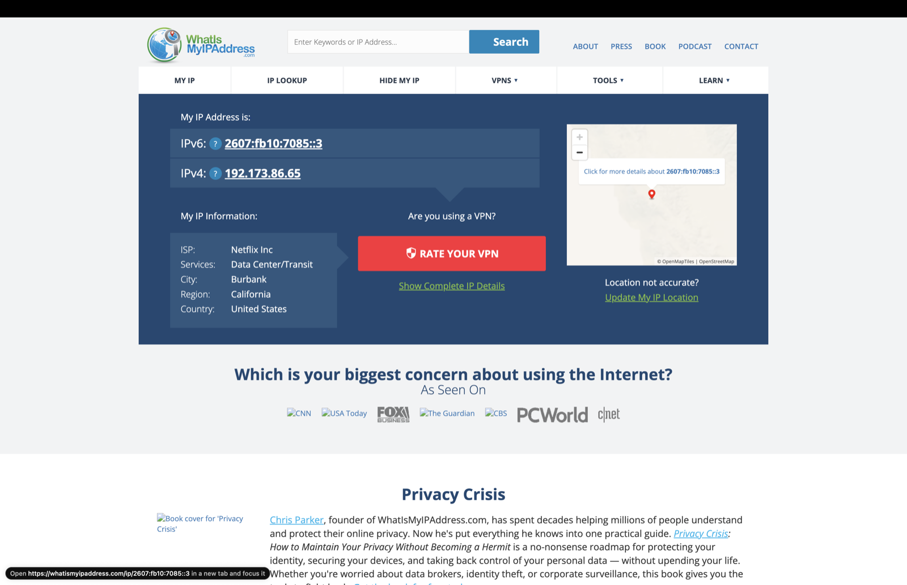
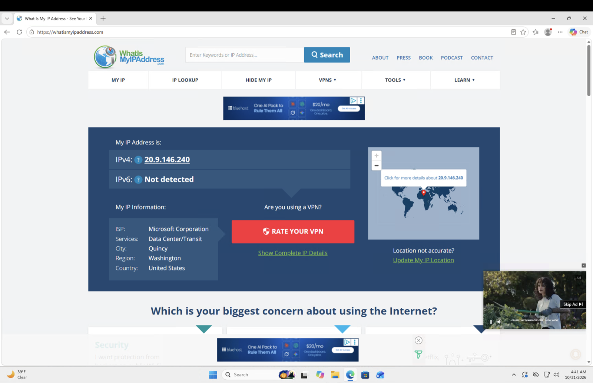
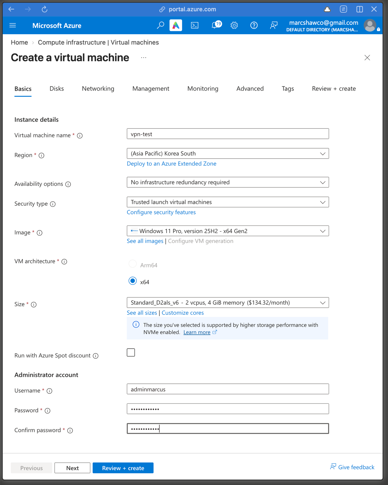
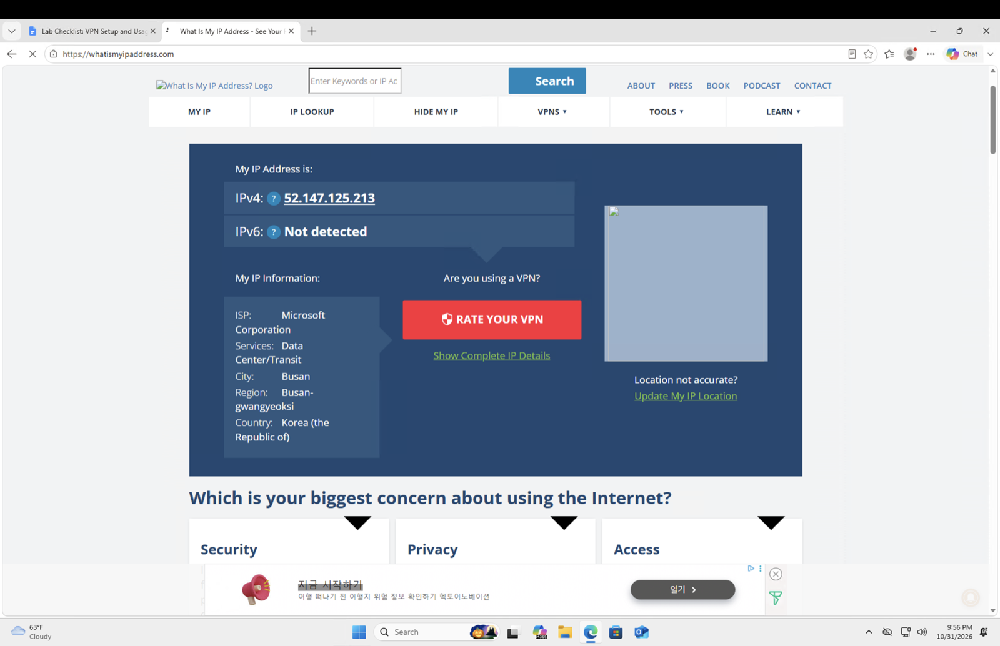
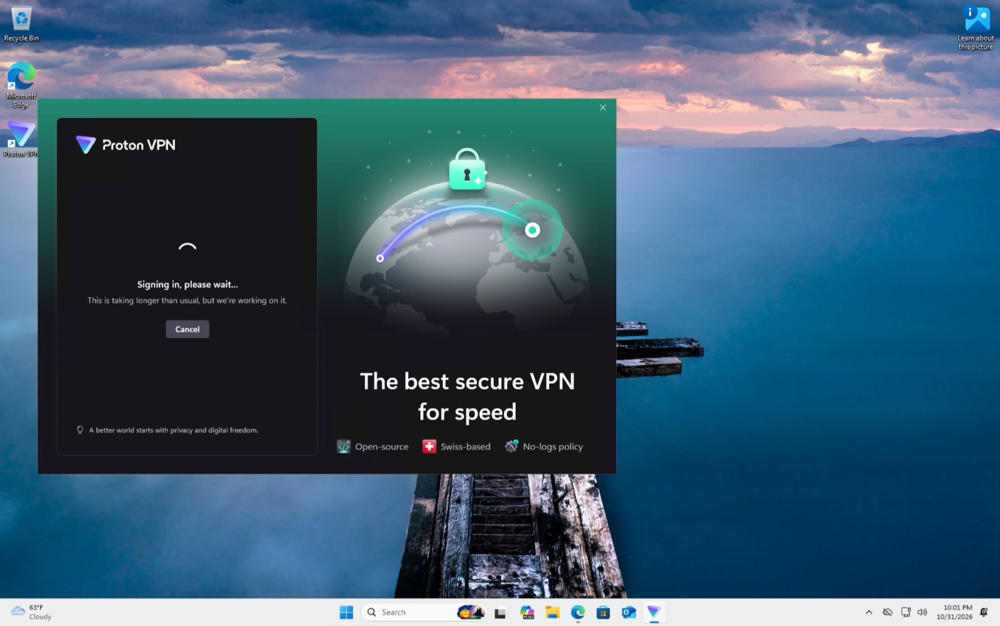
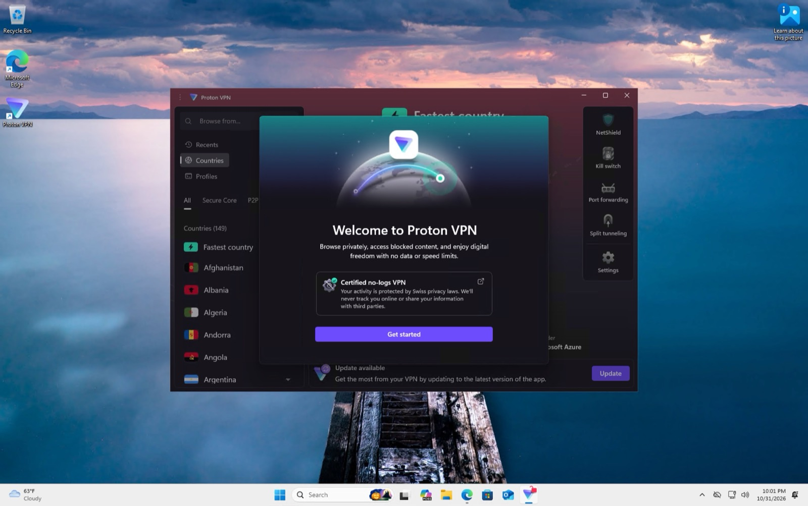
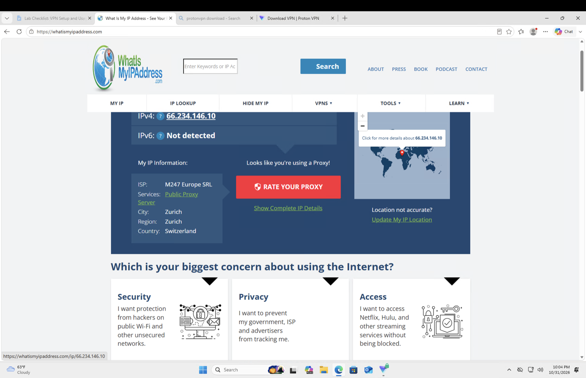
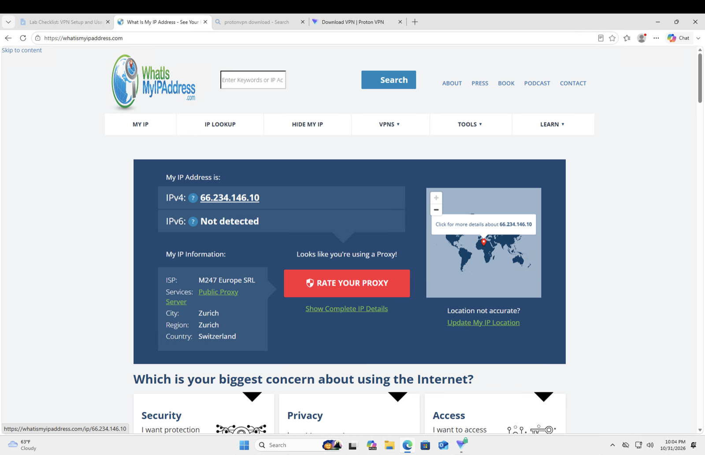

# Lab 4: VPN and geolocation

Check what the public internet thinks my location is from three different vantage points: my own connection, an Azure VM on another continent, and that same VM behind a commercial VPN. Same browser, same website, three different answers.

A VPN is easier to understand when you can watch your apparent location move.

| | |
|---|---|
| Test site | whatismyipaddress.com |
| VM | `vpn-test`, Windows 11 Pro 25H2, Korea South |
| VPN | Proton VPN, free tier |
| Access | RDP from macOS |

## Why bother

Two use cases, and they are structurally the same thing.

Corporate: you work from home, the systems you need sit on a private network behind the company firewall, and private addresses are not routable from the internet. A VPN client builds an encrypted tunnel to the edge of that network, and from then on your traffic arrives as though you were at a desk inside the building.

Consumer: you want sites to stop seeing your home address. The tunnel terminates at a provider's server instead of your employer's, and sites see that server.

Either way, the thing that changes is where your traffic appears to come from.

## Hop 1: my own connection

Baseline from my Mac, no tunnel.

My actual public IP, with the ISP, city, region and country the geolocation database has on file for it.

## Hop 2: an Azure VM

Next, the same site from inside a Windows VM running in Azure West US 2.

Different address, ISP listed as Microsoft Corporation, located in Quincy, Washington. That is where the West US 2 datacenter physically sits.

The site has no idea I exist. The VM made the request, so the VM is what it sees. An RDP session is already a tunnel in this sense, even though nobody calls it a VPN.

To push the geography further I built a VM in Korea South.

Busan, South Korea. I had not moved.

## Hop 3: a VPN on top of the VM

Then Proton VPN inside the Korean VM, which stacks a second tunnel on the first.

The client is the piece that holds the configuration for reaching the provider's gateways. Corporate clients like Cisco AnyConnect work the same way, they just point at a company gateway instead of a provider's.

On the free tier you do not choose the exit country; the client picks one. It landed on Switzerland.

Zurich, Switzerland, ISP listed as M247 Europe. The site also flags the address as a public proxy, which is worth noticing: commercial VPN exit ranges are known and catalogued, so "I have a VPN" is not the same as "nobody can tell I have a VPN".

## The three results

| Vantage point | Apparent ISP | Apparent location |
|---|---|---|
| My own connection | My ISP | Burbank, California |
| Azure VM, West US 2 | Microsoft Corporation | Quincy, Washington |
| Azure VM, Korea South | Microsoft Corporation | Busan, South Korea |
| Same VM, Proton VPN | M247 Europe | Zurich, Switzerland |

The last two rows are the ones that matter. Same VM, same browser, minutes apart. Only the tunnel changed.

The effect is visible beyond the test site. Google served a German-language interface and Disney redirected to disney.de, because both localise on the apparent source address.

## Privacy, accurately

A VPN moves the point at which your traffic enters the public internet. That is all it does.

The provider still sees the traffic, which is why "no-logs policy" is the claim their marketing leads with. Law enforcement can and does follow the chain back through the provider in cooperating jurisdictions. And if you sign in to an account, the account identifies you regardless of where the packets came from.

The honest description is a layer of privacy, not anonymity.

## What I can speak to

- Public versus private addressing, and why private ranges need a tunnel to be reachable
- What a VPN client actually does, and that corporate and consumer clients differ in destination, not mechanism
- Why geolocation follows the IP address and not the device
- Reading an Azure region as a physical location
- The limits of a VPN, stated accurately rather than as marketing
- Troubleshooting the VPN client, which is the usual help desk version of this topic

---

[Back to all labs](../../README.md) · Previous: [osTicket help desk](../03-osticket-helpdesk/) · Next: [Active Directory](../05-active-directory/)
