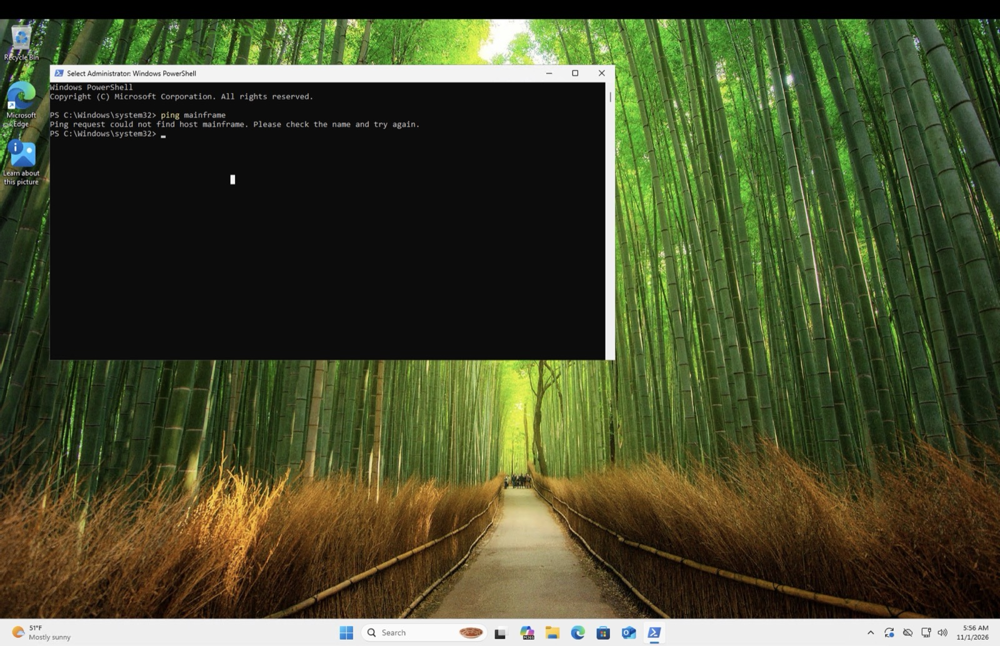
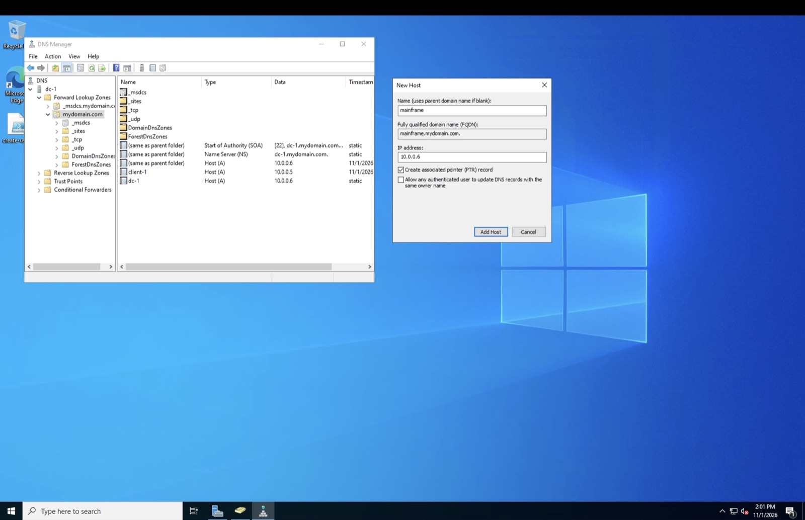
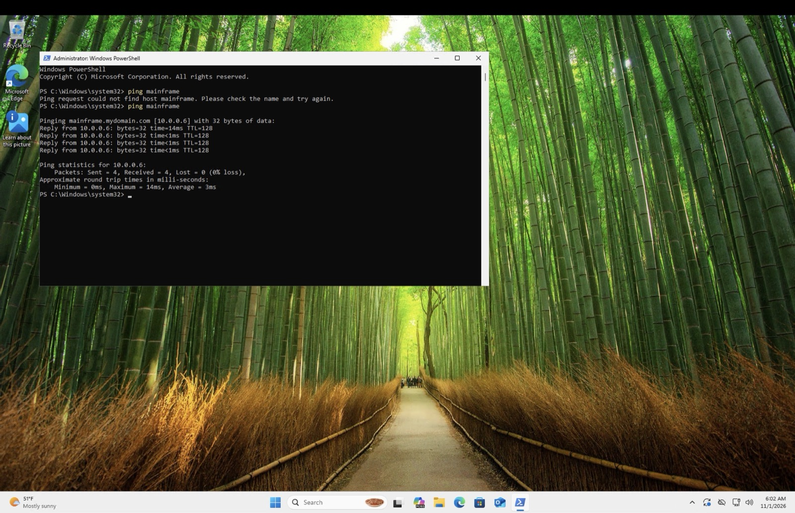
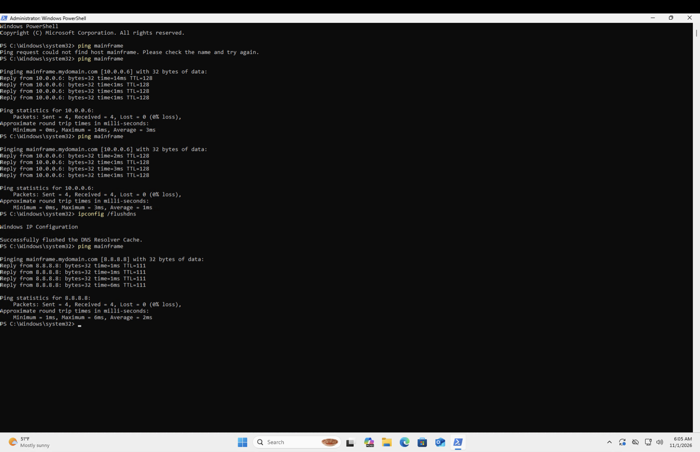
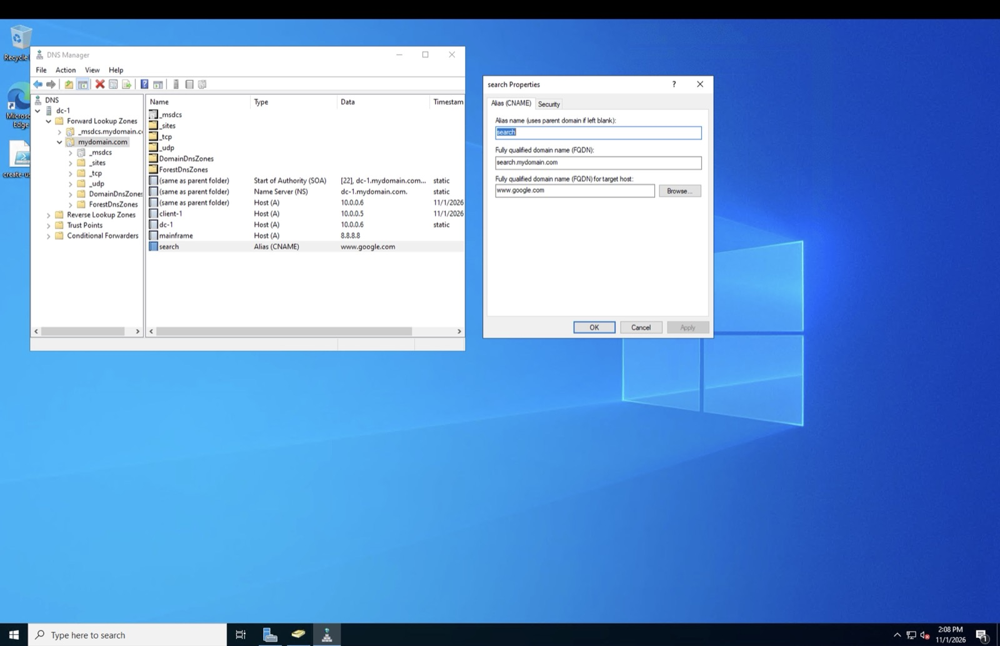
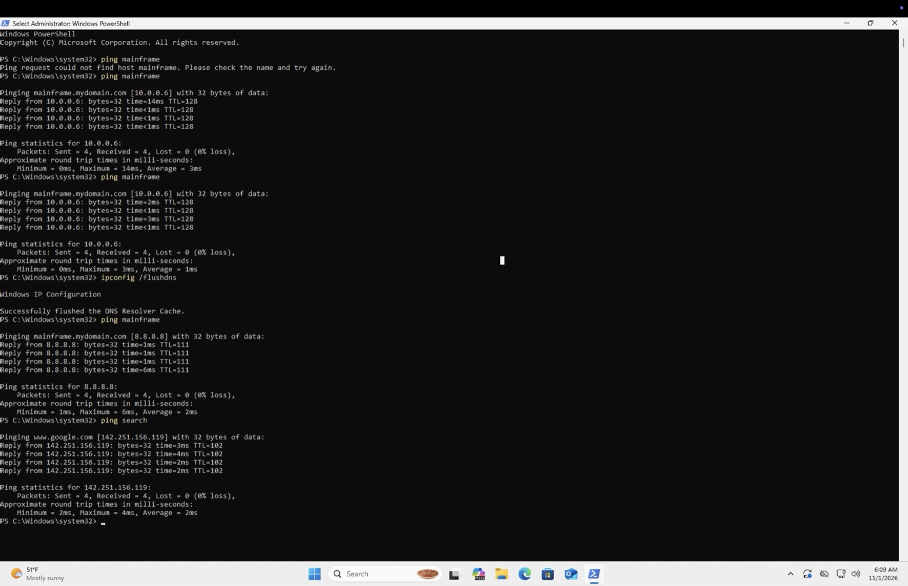
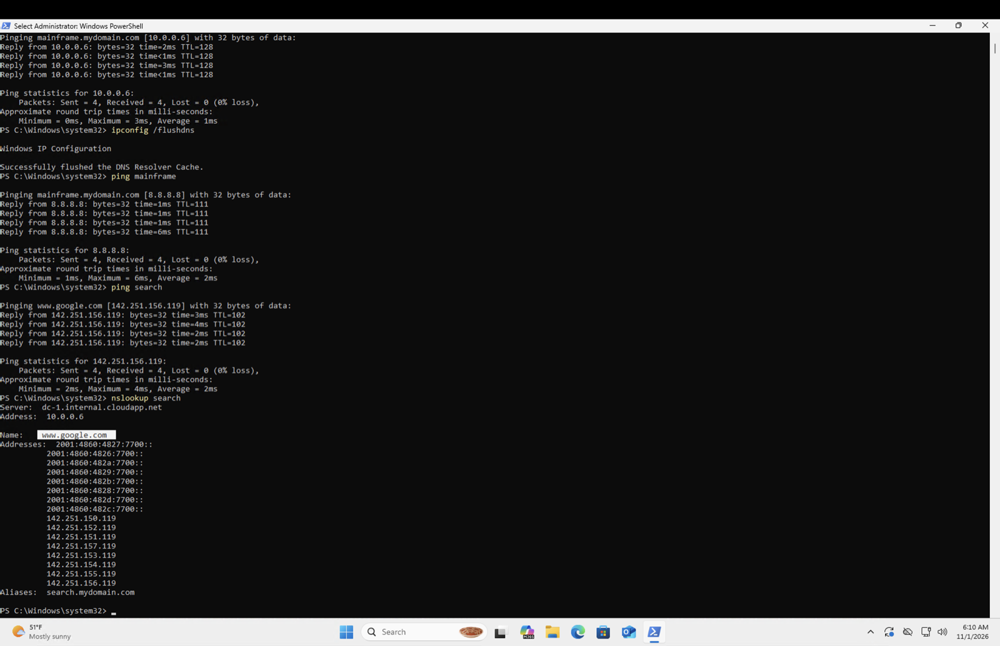

# Lab 6: DNS

Use the domain controller from lab 5 as a DNS server. Create records, resolve them from the client, then change a record behind the client's back and watch it keep resolving to the old address until the cache is cleared.

That last part is the lab. Stale DNS cache is behind a large share of "it works for everyone except me" tickets, and seeing it happen once makes it recognisable forever.

| | |
|---|---|
| DNS server | `dc-1`, 10.0.0.6, installed with AD DS |
| Client | `client-1`, 10.0.0.5, DNS pointed at dc-1 |
| Zone | `mydomain.com`, forward lookup |
| Records | A record `mainframe`, CNAME `search` |
| Tools | DNS Manager, PowerShell, `nslookup`, `ipconfig` |

Built on the domain from [lab 5](../05-active-directory/).

## Resolution order

DNS turns names people can remember into addresses machines can route to. When a Windows client resolves a name it checks three places, in this order:

1. The local DNS cache, held in memory. Fastest.
2. The hosts file, at `C:\Windows\System32\drivers\etc\hosts`. On disk, still local.
3. The configured DNS server, over the network. Slowest.

It stops at the first answer. That ordering explains nearly every weird DNS problem, because the first two are local to one machine and invisible from the server.

## A record that does not exist

Pinging a hostname the domain has never heard of.

"Ping request could not find host mainframe." The client checked cache, checked the hosts file, asked the domain controller, and got nothing back. `nslookup mainframe` fails the same way.

I also tested the hosts file directly by mapping an arbitrary name to 127.0.0.1 and pinging it. It resolved without the DNS server being involved at all, which is the clearest way to see step 2 of that order working.

## Creating an A record

An A record maps a hostname to an IPv4 address. In DNS Manager, under Forward Lookup Zones > mydomain.com, the zone already holds A records for `dc-1` and `client-1`, created automatically when each machine joined.

I added `mainframe` pointing at the domain controller's address.

Two addresses can have more than one name pointing at them, which is what this does: `dc-1` and `mainframe` both resolve to 10.0.0.6.

Back on the client, it resolves and replies.

The name expanded to the fully qualified `mainframe.mydomain.com`, because the client appends its primary DNS suffix to an unqualified name.

## Caching, and how it bites

Now the interesting part. On the server, I repointed `mainframe` from 10.0.0.6 to 8.8.8.8.

Then pinged it again from the client without touching anything else.

It still resolved to 10.0.0.6. Twice.

The record on the server was correct. The client never asked, because it had an answer in cache and cache is checked first. `ipconfig /displaydns` showed the stale entry sitting there.

`ipconfig /flushdns` clears it, and the next ping goes out to the DNS server and comes back with 8.8.8.8.

This is worth sitting with, because it is the shape of a real ticket. A file server gets a new address. Most people are fine. One person cannot reach it, insists nothing has changed on their machine, and is correct. Their cache has not expired yet. `ipconfig /flushdns` fixes it in seconds if you know to look there, and the alternative is a long and useless conversation about whether the server is up.

The same logic covers the hosts file, which does not expire at all. An entry someone added months ago will override DNS indefinitely.

## CNAME records

A CNAME maps one name to another name, rather than to an address. I created `search` pointing at `www.google.com`.

`ping search` resolves through to `www.google.com` and pings Google's address.

`nslookup search` is the clearer view: it returns the name `www.google.com`, its A and AAAA records, and lists `search.mydomain.com` as the alias. The chain is visible.

Loading `search` in a browser fails on a certificate error, which is correct and worth understanding. Google's certificate covers `www.google.com`, not `search.mydomain.com`, so the name the browser asked for does not match the name the certificate vouches for. DNS resolved fine; TLS is a separate check.

## Root hints

The domain controller is authoritative for `mydomain.com` and nothing else. When the client asks it for `google.com`, it has no record, so it works down from the root servers listed in its root hints, which are installed automatically with the DNS role.

That recursion is why one internal DNS server can answer for the whole internet without holding any of it.

## What I can speak to

- The client resolution order, and why the first two steps are invisible from the server
- A records, CNAME records, and when each is the right choice
- Creating and editing records in DNS Manager
- Diagnosing stale cache with `ipconfig /displaydns` and fixing it with `/flushdns`
- Checking the hosts file as a cause of per-machine resolution problems
- Reading `nslookup` output, including alias chains
- Why a working DNS record can still produce a certificate error in a browser
- What root hints do and why an internal DNS server can resolve external names

---

[Back to all labs](../../README.md) · Previous: [Active Directory](../05-active-directory/) · Next: [File shares and permissions](../07-file-shares-permissions/)
