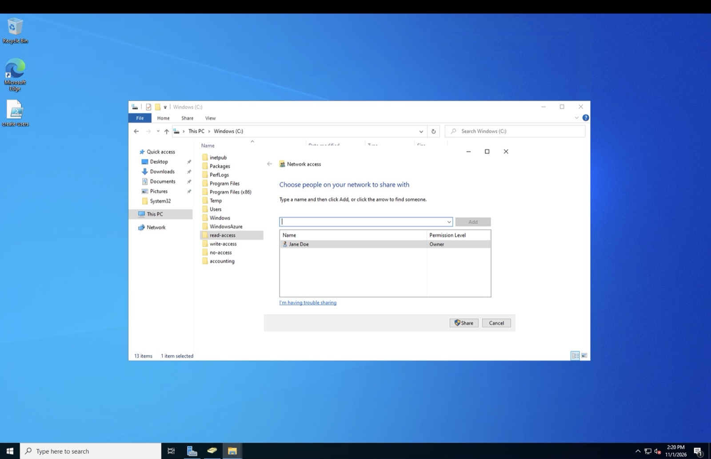
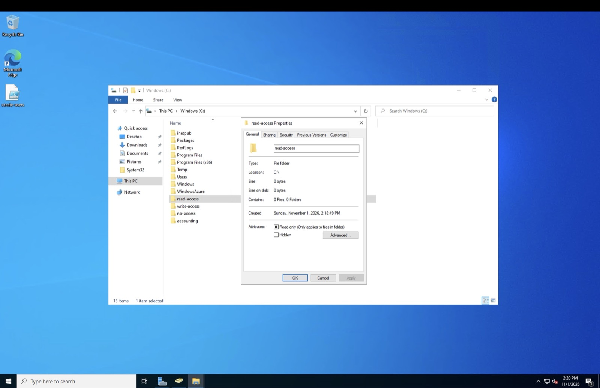
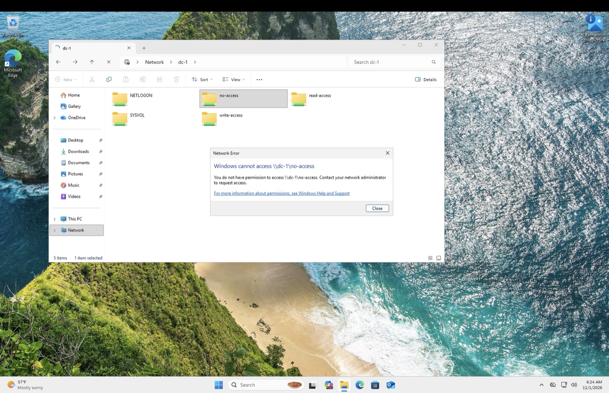
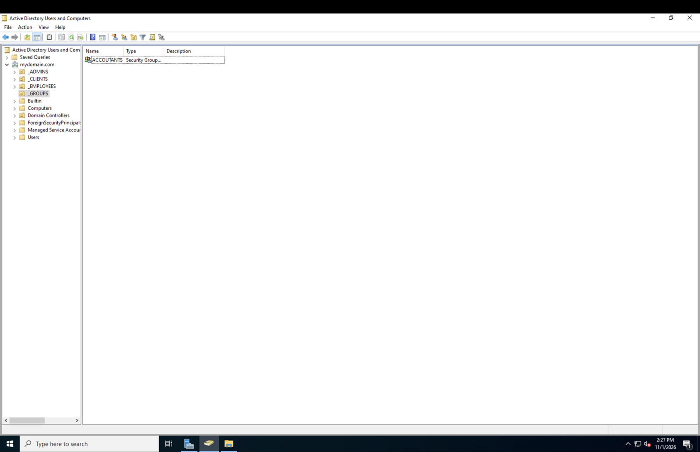
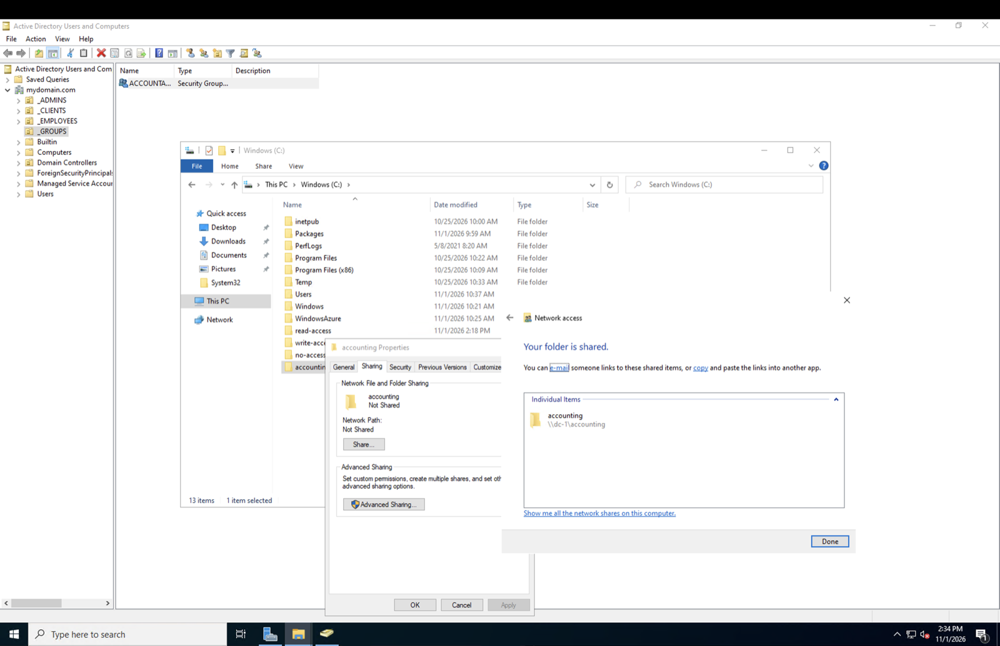
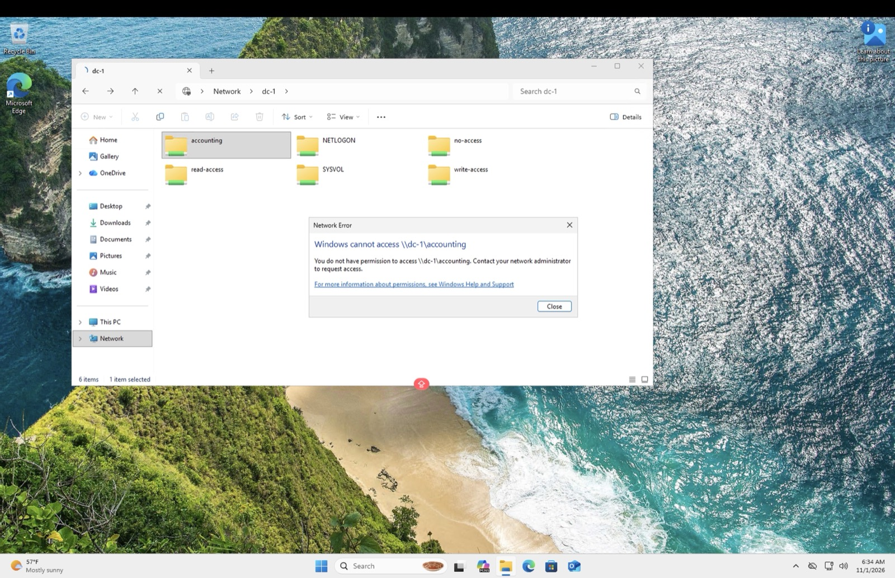
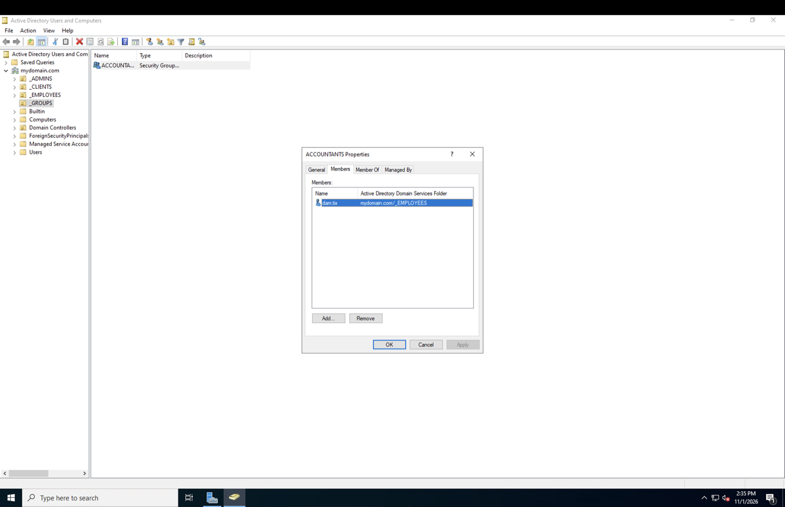
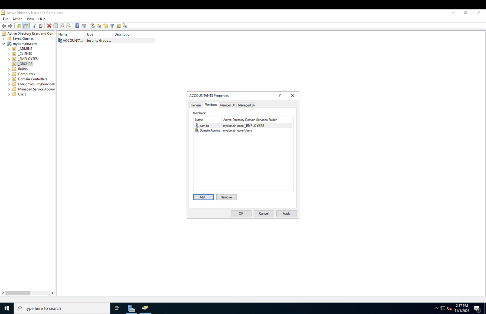

# Lab 7: File shares and permissions

Four folders shared from the domain controller with four different permission settings, then access tested from a client as an ordinary user. Then the same thing done properly: a security group, permissions granted to the group, and a user added to it.

The second half is the part that matters. Granting access to a group instead of a person is the difference between administration that scales and administration that does not.

| | |
|---|---|
| File server | `dc-1` |
| Client | `client-1` |
| Test account | `dam.tix`, one of the 10,000 generated in lab 5 |
| Shares | `read-access`, `write-access`, `no-access`, `accounting` |
| Group created | `ACCOUNTANTS`, global security group in the `_GROUPS` OU |

Built on the domain from [lab 5](../05-active-directory/). The folder names describe the access I intended to grant, not anything inherent to the folders.

## Setting up the shares

Four folders on the domain controller's C drive, shared over SMB with different permissions.

| Folder | Granted to | Level |
|---|---|---|
| `read-access` | Domain Users | Read |
| `write-access` | Domain Users | Read/Write |
| `no-access` | Domain Admins | Read/Write |
| `accounting` | nothing yet | not shared yet |

The test account, `dam.tix`, is a member of Domain Users and not of Domain Admins. Every generated account in lab 5 is, by default.

## Testing as a standard user

From the client, signed in as `dam.tix`, `\\dc-1` lists what the server is sharing.

Three shares, plus NETLOGON and SYSVOL, which every domain controller publishes. `accounting` is absent, because it has not been shared.

The results, folder by folder:

- `read-access` opens, contents are visible, creating a file is refused with a permission error.
- `write-access` opens and a file can be created, opened, edited and saved.
- `no-access` will not open at all.

Three permission levels behaving exactly as configured, verified by doing the thing rather than by reading the ACL.

The distinction between `read-access` and `no-access` is worth stating clearly. On the first, the user can see the contents and cannot change them. On the second, the user cannot see anything. Both are denials, and users describe both as "I can't get into the folder", so the first question is always whether they can see it.

## Doing it with a security group

Granting permissions to individuals does not scale. Ten users is ten grants to set up and ten to clean up when someone leaves. The alternative is a group.

A global security group, `ACCOUNTANTS`, in a `_GROUPS` OU.

Then read/write on the `accounting` folder, granted to the group rather than to anyone in particular.

Back on the client, `accounting` now appears in the list, because it is shared. Opening it fails.

Which is the behaviour to expect. The share exists and is visible, but `dam.tix` is not in `ACCOUNTANTS` and so holds no permission on it.

Adding the user to the group:

Then signing out and back in. That step is not optional. Group membership is read at logon and written into the user's access token, so an existing session carries the old membership until it ends.

This is the single most common cause of "I added them to the group and it still doesn't work". The fix is to log off and back on.

The folder opens, and a file can be created and edited.

## Nested groups

Groups can contain other groups, not only users.

Adding a group to `ACCOUNTANTS` means every member of that group inherits the permission, without touching the folder's permissions again.

That is useful and it is also how permission sprawl happens. Someone gets access to a share through membership of a group that is a member of a group that was granted access three years ago, and nobody can explain why. Which is the argument for auditing group membership rather than folder permissions when a question comes up.

## Testing the chain end to end

Last check: sign in as a completely different generated user who has never touched this share and whose only relevant property is membership of the inherited group. Access worked, which confirms the permission came through the group chain rather than through anything specific to the first account.

That is the test worth doing. Verifying with the account you have been using all along proves less than verifying with one you have not.

## What I can speak to

- Creating SMB shares and setting share permissions
- The difference between no access and read-only, and why users describe both the same way
- Creating security groups in Active Directory and assigning permissions to groups rather than users
- Why group membership changes need a logoff and logon to take effect
- Nested group membership, and auditing it when permissions do not match expectations
- Testing access with a second, uninvolved account rather than the one already in hand
- That this permission model generalises beyond Windows, to anything with an access control list

---

[Back to all labs](../../README.md) · Previous: [DNS](../06-dns/)
